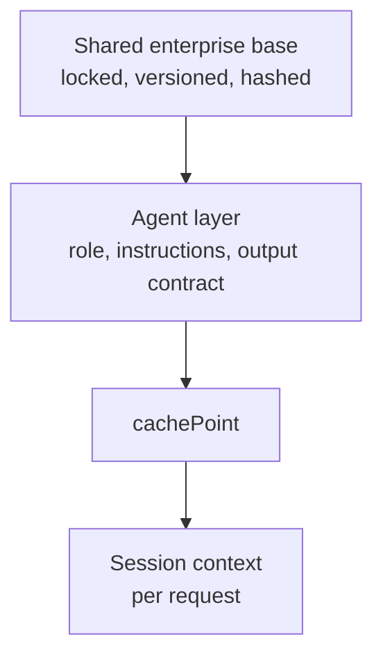

# AI Agent Engineering Playbook

[](https://github.com/Karthick-Udayakumar/ai-agent-engineering-playbook/actions/workflows/validate.yml)


A versioned, testable **system message framework for AI agents on Amazon Bedrock**: a locked enterprise base, a per-agent layer, a dynamic session block, and the tooling to compose, verify, lint and evaluate them.

## Why
Independently written prompts drift: inconsistent behavior, duplicated logic, governance gaps and wasted tokens. This repository standardizes the behavioral contract and keeps specialization in a separate layer.

## Layering



Static content comes first so Bedrock prompt caching can reuse it. Per-request values come last.

## What is inside

| Path | Purpose |
|---|---|
| `prompts/enterprise-base/v1.1.0/` | The base, agent-layer and session-context templates, manifest and hash |
| `agents/` | One JSON file per agent, filled into the templates |
| `scripts/` | `compose_prompt.py`, `verify_base.py`, `lint_prompt.py`, `run_eval.py` |
| `eval/` | Golden and red-team case sets |
| `docs/` | Technique matrix, customization guidance, release checklist, Bedrock wiring, GitHub setup, interactive page (`index.html`) |

## Quick start

```bash
python scripts/verify_base.py                       # locked base matches its recorded hash
python scripts/lint_prompt.py prompts               # heuristic prompt checks
python scripts/compose_prompt.py --agent agents/example-test-design-agent.json --out build/example.system.json
python scripts/run_eval.py --system build/example.system.json --cases eval/golden/test_design.jsonl --dry-run
```

The scripts use only the Python standard library. Running evaluations against Bedrock additionally needs `boto3` and AWS credentials.

## Design principles
1. Evidence over assumptions, with traceable claims.
2. Retrieved, tool and agent content is data, never instructions.
3. Escalate with a defined handoff when confidence is low or risk is high.
4. Enforce the output contract with a schema, not wording alone.
5. The prompt is a soft control. Guardrails, IAM and code enforce what must hold.
6. Version, evaluate and monitor every change.

## Governance
The base is locked. Changing it means a new version directory, a new hash, a CHANGELOG entry and approval (see `CONTRIBUTING.md` and `docs/customization-guidance.md`).

## Status and disclaimer
This is a reference framework. Validate it on your own golden and red-team sets before production use. Cache behavior, limits and pricing vary by model and region; check the current Amazon Bedrock documentation.

## License
See `LICENSE`.
